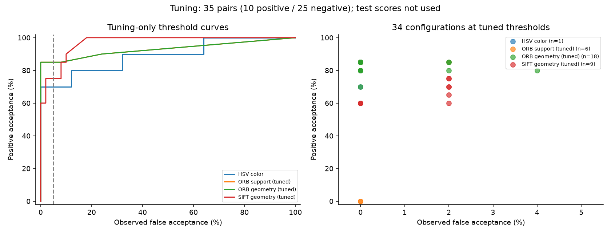
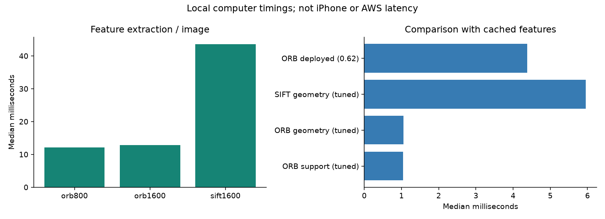

# Diverse archived-photo study: exploratory AI-reviewed comparison

## Scope and provenance

144 archived photographs form 96 pairs from 24 GPS blocks. Existing 641-photo and human-labeled pools were excluded. Blocks were separated into 12 tuning and 12 held-out groups before scoring. GPS/time selected candidates, not visual labels. There is no image/hash overlap across the split. This is a retrospective photo study, not new field capture or a user study.

The user authorized ChatGPT image uploads. A worker and the primary assistant reviewed contact sheets without algorithm scores. Only agreement on same/different was retained: 74 pairs (24 positive, 50 negative); 22/96 were excluded. Ten pair labels disagreed and twelve were jointly uncertain. These are two AI passes, not human ground truth or statistically independent annotation. The primary assistant saw the worker's uncertainty summary before completing its last 24 reviews. No uncertain label was resolved using scores. Excluding ambiguous views can make the task easier.

Tuning contains 35 retained pairs (10 positive, 25 negative), with 13 exclusions. Held-out evaluation contains 39 retained pairs (14 positive, 25 negative), with nine exclusions. Both directions share images and must not be counted as independent trials. Near-duplicate bursts and a single person's archive limit diversity. Full scene-level independence is not established by GPS separation.

## Frozen comparison

Four method families and 34 configurations were scored. Each family selected parameters/threshold on tuning data alone, maximizing positive acceptance under observed false acceptance <=5%, then fewer false accepts and lower comparison time. Selection and label hashes were frozen before the test file was opened. No held-out retuning was performed. The deployed ORB threshold 0.62 remained a separate unchanged anchor.

| Method | Frozen threshold | Same accepted | Different accepted | Comparison ms |
|---|---:|---:|---:|---:|
| HSV color | 0.437668 | 18/28 | 8/50 | 0.005 |
| ORB support (tuned) | 0.083333 | 15/28 | 0/50 | 1.042 |
| ORB geometry (tuned) | 0.022500 | 15/28 | 0/50 | 1.054 |
| SIFT geometry (tuned) | 0.348396 | 19/28 | 3/50 | 5.951 |
| ORB deployed (0.62) | 0.620000 | 12/28 | 0/50 | 4.377 |

## Interpretation and deployment decision

SIFT recovered more positives but produced three false acceptances; color similarity produced eight. The current ORB setting missed sixteen of twenty-eight positive directions. Thus the expanded test exposes substantial viewpoint/visible-area limitations, rather than establishing broad robustness.

The tuned ORB geometry threshold is only 0.0225001. It can accept the production scoring fallback for fewer than eight correspondences, before any homography exists. Its result equals tuned descriptor support on this set; it is not evidence that geometric verification improved. A future calibration should require a valid homography and a minimum inlier count as hard constraints, then be assessed on a new held-out set. We preserve this failed selection outcome and do not deploy it.

## Observed failures and application implications

- The railway views new_037/038 and oblique temple views new_085/088 were missed in both directions by every feature-based selected method. Shared structure is visible to the AI reviewers, but framing, scale and foreground occlusion differ. These observations suggest conditions to investigate; they do not isolate a causal mechanism.
- SIFT false acceptances occur in new_045 A-to-B, new_055 A-to-B and new_072 B-to-A. The pairs depict different subjects or views. Geometric estimation alone does not guarantee meaningful scene correspondence at this permissive threshold.
- Strongly related views of distinctive objects and stable surroundings remain useful candidates. The deployed model's category counts are supplied in category_results.csv; categories are small and confounded, so no category ranking is claimed.
- Product guidance should ask users to include stable distinctive background structure and return to similar framing. A future registration quality check, multi-view capture and hard geometry gate need separate evaluation. No user benefit or improvement from these unimplemented changes is claimed.

All errors, including low-scoring positives, remain in failures.csv. Existing human-labeled evidence and actual-photo illustrations remain separate in PHOTO_BENCHMARK.md.

## Runtime and reproducibility

Times are local computer observations with cached features. They exclude photo decoding, full archive retrieval, network and display. Median feature extraction over 144 photos is about 12.2 ms for ORB800, 12.9 ms for ORB1600 and 43.6 ms for SIFT1600. No histogram extraction timing was recorded; its comparison-only time cannot establish full-pipeline superiority. These are not iPhone or AWS performance estimates.

Anonymized score rows, splits, labels, label provenance, selection hashes and all failure records are in docs/evidence/diverse-study. Private paths, GPS coordinates, timestamps and originals are excluded. Aggregate results and plots are reproducible from these rows using Tools/report_diverse_study.py --from-evidence; feature extraction from private originals is not reproducible from the public package. Full regeneration uses prepare_diverse_pairs.py, compare_vision_methods.py, finalize_ai_labels.py and calibrate_vision_methods.py in that order. Frozen outputs prevent silently replacing the first evaluation.

## Rubric contribution and remaining priorities

This study supports technical execution and documentation by showing a separate tuning/test protocol, algorithm/parameter comparisons, speed tradeoffs and measured failures. It does not replace a working demonstration or evidence of user benefit. The remaining submission priorities are the actual app/AWS demo video, judge access and final submission. Official criteria: https://opencv26.devpost.com/rules .
