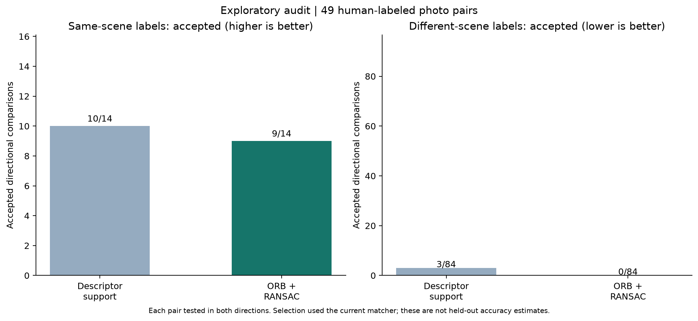
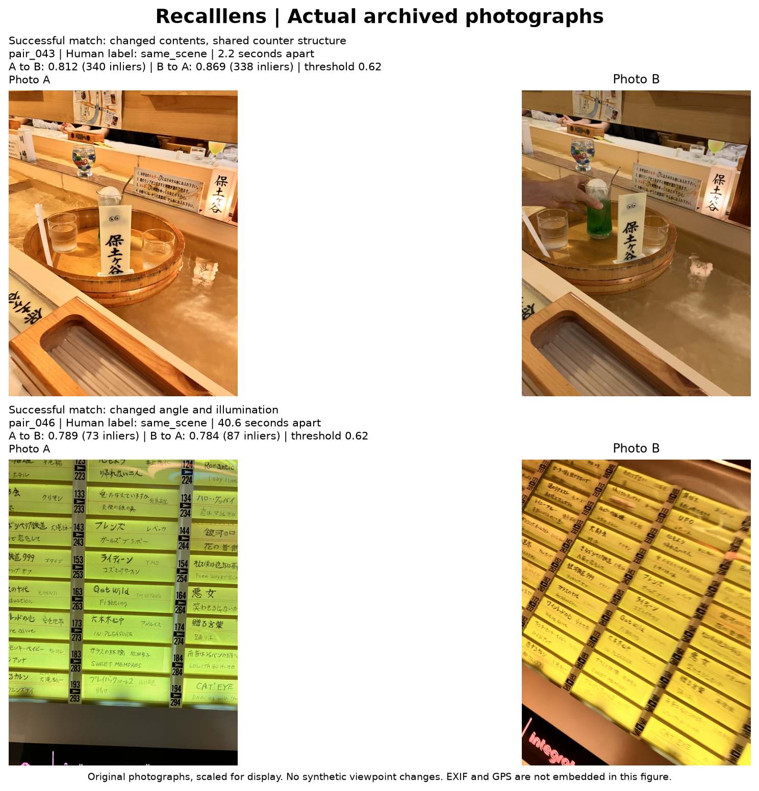
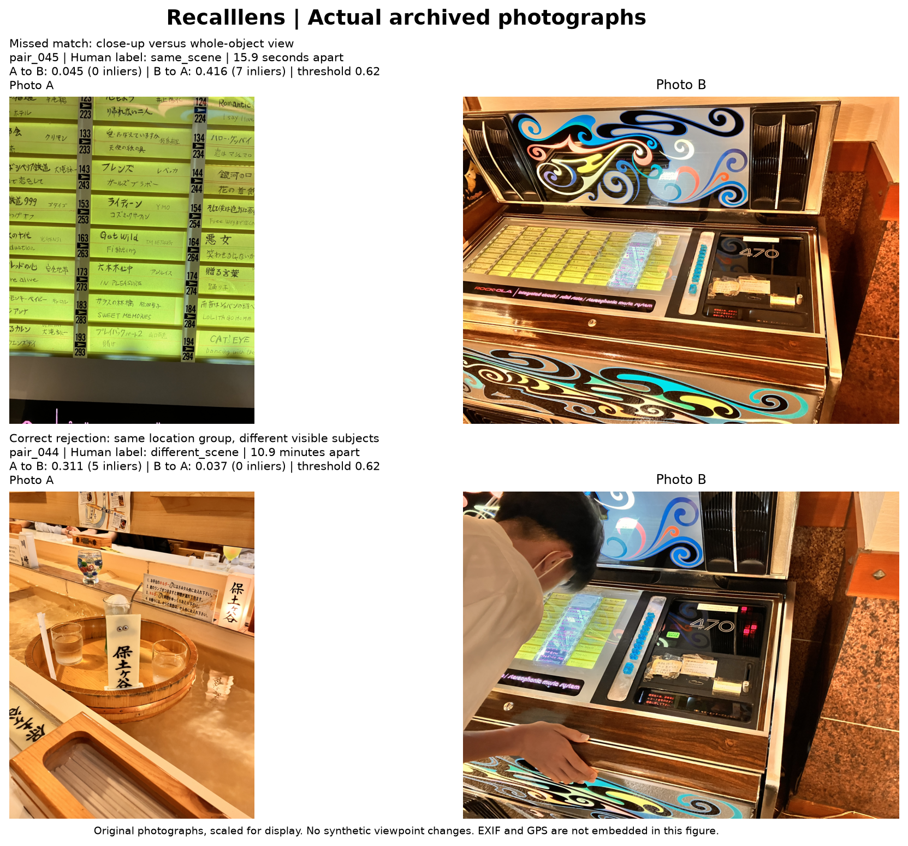
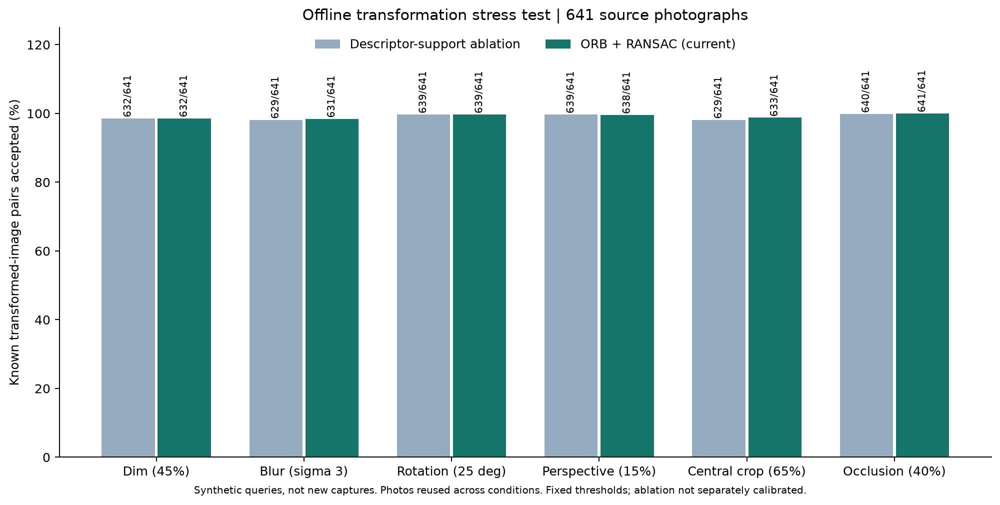

# Recalllens - Retrospective photographic evaluation

## Evidence and scope

This evaluation uses **641 existing photographs**, not newly captured field trials. The sources are 129 supplied stills and 512 additional Apple Photos originals. The latter were selected by SHA256 ordering of asset identifiers from locally available files with valid coordinates in an existing metadata manifest. Selection did not use the matcher's similarity score. All selected files decoded; exact-file deduplication found no duplicate selected files. These are photographs, not necessarily distinct scenes or independent visits.

Each source received six fixed synthetic transformations and an identity control: 3,846 transformed positive comparisons plus 641 identity controls. The original image was the reference. Transformations were generated in memory; no images were uploaded. The threshold stayed at the pre-existing 0.62 throughout the experiment. There was no search for the best threshold on these results.

Separately, all 49 existing human-labeled photo pairs were evaluated in both directions: 7 same-scene pairs and 42 different-scene pairs, giving 14 positive and 84 negative directional comparisons. Their original selection used the current matcher, so this is an exploratory audit with selection bias. Reverse directions are correlated observations of the same pair, not new independent examples.

## Existing natural-photo pair audit

| Method / direction | Same-scene accepted | Different-scene accepted (errors) |
|---|---:|---:|
| ORB + RANSAC / A_to_B | 5/7 | 0/42 |
| ORB + RANSAC / B_to_A | 4/7 | 0/42 |
| Descriptor support / A_to_B | 5/7 | 2/42 |
| Descriptor support / B_to_A | 5/7 | 1/42 |

Across both directions, ORB + RANSAC accepted 9/14 positive comparisons and 0/84 negative comparisons. Descriptor support accepted 10/14 and 3/84 respectively. At these settings, geometric verification rejected the three negative comparisons accepted by the ablation but also missed one additional positive comparison. Zero observed false accepts does not imply zero risk outside this selected sample.

12 of the 49 pairs share the same capture date in the metadata manifest; 37 have different dates. Date similarity and GPS proximity are contextual metadata, not the visual ground truth. No success rate for a new visit is inferred from those counts.

## Illustrated real-photo cases

The seven positive pairs involve eight photographs within one GPS candidate group. This narrow scene coverage limits generalization. The figures below show separately captured originals, oriented and scaled for presentation with EXIF omitted; scores were computed before rendering.

Pair_043 preserves counter structure despite changed contents. Pair_046 preserves song-list correspondence under a different angle and illumination. Both pass in both directions.

Pair_045 is a user-labeled same-scene pair comparing a close-up with the full jukebox; it fails in both directions. Scale and visible area differ substantially, though this case alone does not isolate a causal explanation. Pair_044 shows different subjects in the same location group and is correctly rejected. Case selection illustrates outcomes and is not an additional accuracy sample.

## Supplement: synthetic transformation results

| Transformation | ORB + RANSAC accepted | Descriptor support accepted |
|---|---:|---:|
| identity_control | 641/641 | 640/641 |
| dim_45pct | 632/641 | 632/641 |
| blur_sigma3 | 631/641 | 629/641 |
| rotation25 | 639/641 | 639/641 |
| perspective15pct | 638/641 | 639/641 |
| crop65pct | 633/641 | 629/641 |
| occlusion40pct | 641/641 | 640/641 |

Brightness was multiplied by 0.45; Gaussian blur used a 15-pixel kernel and sigma 3; rotation was 25 degrees; perspective corners shifted by the fixed fractions in the protocol; a central 65% crop was resized; occlusion replaced the left 40% with black. These planar digital transformations preserve correspondence by construction. They do not simulate all changes in real revisits, such as depth-dependent parallax, seasonal change, or moving objects. There are no negative examples in this stress test, so it cannot measure false-acceptance rate.

The diagnostic ablation uses min(ratio-test match count / 36, 1) at 0.62, removing geometric verification. It is not independently calibrated or claimed to be the strongest competing method. The comparison isolates a design tradeoff at fixed settings; it does not establish statistical superiority.

## Recorded failures

All five missed positive directions are listed here, without exposing private photographs:

| Pair | Direction | Score | Threshold |
|---|---|---:|---:|
| pair_045 | A_to_B | 0.045000 | 0.62 |
| pair_045 | B_to_A | 0.416389 | 0.62 |
| pair_047 | B_to_A | 0.617837 | 0.62 |
| pair_049 | A_to_B | 0.372574 | 0.62 |
| pair_049 | B_to_A | 0.281988 | 0.62 |

One direction of pair_047 scored 0.617837, just below the fixed 0.62 threshold. The threshold was not lowered after observing this failure. The other two missed pairs fail in both directions. The illustrated whole-object/close-up pair shows a large change in scale and visible area. This is an observation, not a controlled causal finding; causes of the remaining failures are not established.

## Runtime and reproducibility

Runtime: Python 3.12.3, OpenCV 5.0.0, macOS-27.0.1-arm64-arm-64bit. The recorded OpenCV thread setting was 8. Desktop cached-feature pair comparison had median 17.32 ms and p95 18.60 ms across stress comparisons. This is descriptive timing on a development computer with other work running; it excludes image loading, feature extraction, searching the full archive, network requests, and the phone's temporal stabilization.

The run saves protocol, per-comparison rows, environment, source hashes, a private source-file manifest, and exclusions. Scores are reproduced by `Tools/run_photo_benchmark.py` with access to the original photos. `Tools/generate_report_figures.py` regenerates the figures from saved rows. The submission evidence exposes only anonymized result rows and aggregate metadata. Private originals and source paths are not distributed; judges can reproduce the tables and charts, but cannot independently re-extract these private image features from the public package.

## What this evidence supports

The large positive stress test supports robustness to the specified digital transformations. The small natural-pair audit exposes a measured sensitivity/specificity tradeoff. The six-trial iPhone pilot remains separate evidence of client/cloud integration. None of these establishes population-level scene-recognition accuracy, user benefit, location proof, end-to-end camera parity, or protection against a modified client.
