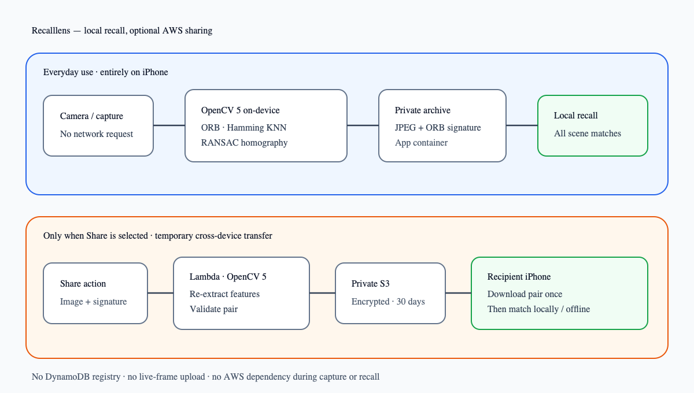
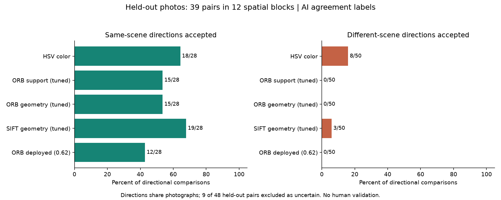
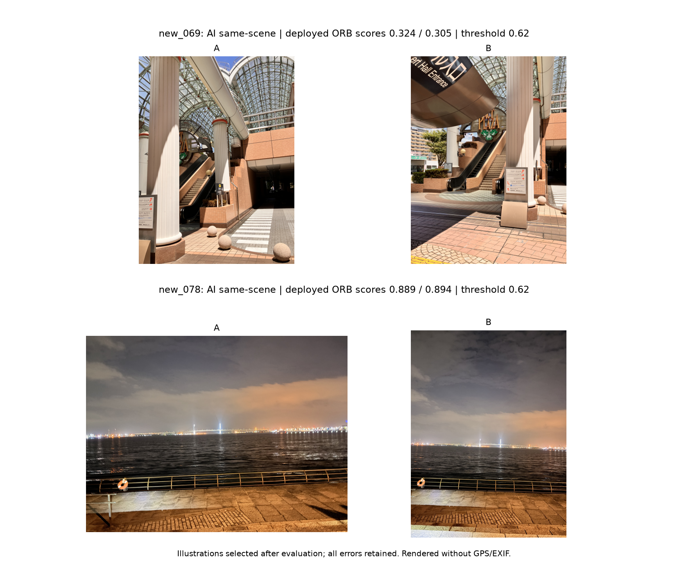
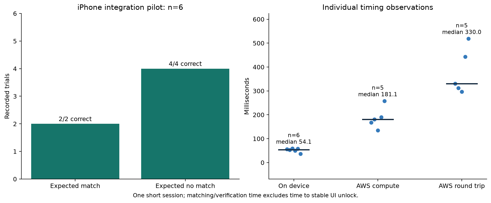

# Recalllens — Technical Report

## Executive summary

Recalllens is a private iOS camera that turns a visible real-world scene into the key for opening photographs captured there. The interaction is intentionally physical: a memory is not retrieved by typing a date, place name, or semantic query. It becomes available when the user returns the camera to sufficiently similar visual structure.

The system uses OpenCV 5.0.0 on both the iPhone and AWS, with deliberately separate roles. Every capture and live-camera match runs locally. AWS is contacted only for explicit account-free sharing: Lambda checks that an uploaded JPEG and ORB signature describe the same scene, then private S3 temporarily delivers that pair. After receipt, matching is again entirely on-device. Ordinary unshared photographs and signatures remain in the iPhone application container.

## Problem, users, and impact

Conventional photo archives optimize for immediate retrieval through timelines, albums, locations, and semantic search. These interfaces recover an image but discard the act of returning to the viewpoint that gave the image meaning. Recalllens explores a complementary interaction: deliberate, place-bound recall.

The initial users are people maintaining personal travel, family, and everyday-life archives. The prototype is most suitable for stable, visually textured scenes such as building facades, rooms, signs, and streetscapes. It is not intended for identity verification, physical access control, or proof of geographic location.

The proposed value is deliberate rediscovery of a personal memory through its visual surroundings. This submission demonstrates that interaction; it does not yet include a user study establishing benefit or adoption. Other applications remain future possibilities.

## User experience

The application opens directly into a camera. Capturing a photograph creates a private archive record and an OpenCV feature signature. During later use, live frames are evaluated at a reduced frequency to control energy use. A stable match reveals the number of photographs associated with the visible scene. Opening the result snapshots all photos available at that moment.

The interface suppresses unstable one-frame matches. Exponential moving-average smoothing, separate entry and exit thresholds, consecutive decisions and a minimum display duration reduce flicker. One representative matching-photo thumbnail appears beside the shutter; its count and swipeable viewer expose every current match. Viewer pages identify received photos. Once a user deliberately opens a photo, the viewer retains that snapshot until manually closed, even if the camera turns away. This does not add a permanently unlocked album.

A background feature check disables capture and provides inline guidance when fewer than eight ORB features are available, the minimum correspondence count used before homography estimation. This is a feasibility guard, not a guarantee that a future view will match. Expected featureless-frame failures no longer trigger repeated modal alerts.

### Account-free sharing

Each capture opens a full-screen review with Save, Share and Discard. A draft stays in memory until Save or Share is selected. Share saves locally, explicitly uploads a downscaled JPEG with its ORB signature and copies an HTTPS link. Main controls, notices, capture guidance and camera permission text support Japanese and English. The landing page contains no photo preview and opens the installed app through a custom URL scheme, with a manual button if the browser blocks automatic launch. Universal Links and App Store distribution are not configured.

The receiver sees only a receipt notice while the validated image-signature pair is saved. Reopening the same link does not duplicate the record. Received photos can be matched without a network connection after receipt. The sender and recipient do not need accounts or a friend list.

## Architecture



The ordinary path is camera -> on-device OpenCV -> local image-signature archive -> on-device recall. The sharing path adds: sender-selected image-signature pair -> Lambda OpenCV pair validation -> private S3 object -> bearer-link recipient -> local archive and matching. This path intentionally prefetches image bytes; it is not server-gated geographic access control.

## OpenCV 5 implementation

The iOS client and Lambda use the same feature and scoring configuration:

- OpenCV 5.0.0
- grayscale input, resized to at most 960 pixels on the longest edge
- ORB with at most 1,600 features, eight pyramid levels, Harris scoring, and FAST threshold 12
- brute-force Hamming KNN matching with `k=2`
- Lowe-style ratio threshold of 0.75
- at least eight surviving correspondences before geometry estimation
- RANSAC homography with a four-pixel reprojection threshold

The final similarity score combines three signals:

```text
0.52 × RANSAC inlier ratio
+ 0.33 × inlier-count support
+ 0.15 × spatial coverage of inlier query points
```

Inlier support saturates at 36 inliers. Spatial coverage saturates when the inlier convex hull reaches 22% of the query frame. The production unlock threshold is 0.62.

This pipeline rejects descriptor matches that lack a coherent planar transformation. OpenCV output directly changes application state: matching photographs remain hidden until local geometric evidence exceeds the threshold.

## Meaningful AWS role

AWS provides an ephemeral cross-device transfer service for photos that users explicitly share. Lambda decodes the upload, strips metadata, re-extracts ORB features with OpenCV 5, and geometrically compares them with the supplied signature. A mismatched pair is rejected. A validated JPEG-signature pair is stored in private encrypted S3 and can be retrieved for 30 days through a random bearer link. There is no ordinary-capture registration endpoint, live-frame verification endpoint, or cloud dependency during recall.

The stack uses arm64 with 1,024 MB memory and a ten-second timeout in AWS Asia Pacific (Tokyo), API Gateway at one request per second with a burst of two, and three-day CloudWatch retention. A monthly budget alert provides notification, not a hard spending cap. The upload token does not separate users. A modified client can bypass the local presentation rule; the prototype is not a tamper-resistant vault.

## Evaluation evidence

### Main study: verification between actual photographs

We evaluated all 49 previously human-labeled pairs of actual photographs from Apple Photos. These are separately captured images, not generated transformations. Both directions were tested because descriptor matching and query coverage can be asymmetric. The existing threshold of 0.62 was fixed before this run.

The 7 same-scene pairs yielded 14 positive directional comparisons; the 42 different-scene pairs yielded 84 negatives. ORB + RANSAC accepted 9/14 positives and 0/84 negatives. A descriptor-support ablation accepted 10/14 and 3/84. At these settings, geometric verification rejected three negative comparisons accepted by the ablation but missed one additional positive. The ablation was not separately calibrated.


The positive labels involve eight photographs within one GPS candidate group, including a counter and a jukebox. The pairs were originally selected through the matcher, and opposite directions share images. This is a limited, selected case study of image-pair verification, not a broad held-out scene-recognition benchmark. The labels are the user's existing pair judgments; independent adjudication and inter-rater agreement were not measured. Zero observed false accepts does not imply zero population risk. GPS grouping was used to find candidates, not determine the visual label.

### Real-image examples

The following figures show existing natural photographs. Images are oriented and scaled for the page; they are not synthetically transformed. Scores are from the frozen full-image evaluation. The four pairs illustrate success, a missed correspondence and rejection rather than constitute a new test set.


Pair_043 shows a common counter structure with changed contents and passes in both directions. Pair_046 shows the song list at different angles and illumination and also passes. These examples demonstrate correspondence despite changes visible in the photographs.


Pair_045 compares a close-up song list with the whole jukebox and is missed in both directions. The photographs differ greatly in the visible area and scale; those are observed differences, not an experimentally isolated cause. Pair_044 compares the counter with the jukebox and is correctly rejected despite membership in the same location group. Sharing a place alone is insufficient for the intended visual match.

All five missed positive directions remain in the results, including pair_047 at 0.617837, just below the fixed threshold. We did not lower the threshold after observing this case. Full counts, failure identifiers and selection limitations are in `docs/PHOTO_BENCHMARK.md`.

### Broader comparison: held-out archived photos with AI-reviewed labels

An additional 144 photographs from 24 GPS blocks produced 96 natural pairs, excluding the earlier photo pools. Twelve blocks were fixed for tuning and twelve for testing, with no image/hash overlap. Four method families and 34 configurations were scored before visual labels were used. GPS and capture time selected candidates; they were not treated as evidence of visual identity.

The user authorized ChatGPT image analysis of these archived photos. Two AI visual passes agreed on 74 pairs (24 same, 50 different); 22 uncertain or disputed pairs were excluded before calibration. These labels have no human validation. The passes are not statistically independent: the primary assistant saw a summary of worker uncertainties before completing its last 24 reviews. This exploratory evidence supplements the human-labeled study rather than replacing it.

Tuning retained 35 pairs (10 positive, 25 negative; 13 exclusions). Test retained 39 pairs (14 positive, 25 negative; nine exclusions). Each split covers 12 blocks; positive pairs occupy five tuning and six test blocks. Both directions share images. A single archive, near-duplicate bursts and exclusion of ambiguous views limit generalization.

Parameters and thresholds were selected only on tuning data to maximize positive acceptance subject to observed false acceptance at or below 5%. Lower false acceptance, then lower comparison time, broke ties. Labels and selection were hashed and frozen before opening test scores. This is an empirical selection rule, not a population error guarantee.

| Method | Threshold | Same accepted | Different accepted |
|---|---:|---:|---:|
| HSV color histogram | 0.4376681 | 18/28 | 8/50 |
| Tuned ORB descriptor support | 0.0833331 | 15/28 | 0/50 |
| Tuned ORB geometry | 0.0225001 | 15/28 | 0/50 |
| Tuned SIFT geometry | 0.3483961 | 19/28 | 3/50 |
| Deployed ORB geometry | 0.62 | 12/28 | 0/50 |



The selected ORB configurations use 800 features and ratio 0.65; geometry uses an eight-pixel RANSAC tolerance. SIFT uses 1,600 features, ratio 0.65 and tolerance eight. All 34 tuning outcomes and the frozen selections are retained in the evidence files.


The tuned ORB geometry threshold is below the fallback score for four descriptor correspondences. It accepted one test direction without the eight correspondences required to estimate a homography. Its aggregate result equals descriptor support, so it does not demonstrate an advantage from geometry. The next calibration should require valid geometry and minimum inlier support, then use a new held-out set. We have not adopted the permissive tuned setting or changed the deployed threshold.

SIFT detects more positives but falsely accepts three negative directions (new_045 A-to-B, new_055 A-to-B and new_072 B-to-A). The deployed ORB misses 16/28 positive directions. This broader evaluation reveals a material recall limitation. It supports further work on registration quality, similar-view guidance and multiple reference views; their benefit has not yet been measured.



The canopy pair new_069 shares structural elements but changes viewpoint and framing; the deployed model misses both directions. The waterfront pair new_078 is accepted in both directions despite night lighting. These illustrations were selected after evaluation and cannot establish which visual factor caused success or failure. All errors remain in the anonymized failure table.


On the local computer, median extraction over 144 photographs was 12.2 ms for ORB800, 12.9 ms for ORB1600 and 43.6 ms for SIFT1600. Median held-out comparison with cached features was 1.05 ms for tuned ORB geometry, 4.38 ms for the deployed configuration and 5.95 ms for SIFT. These exclude image decoding, full-archive search, networking and display. They are not iPhone or AWS timings; histogram preprocessing was not timed.

Full protocol, exclusions, category counts and limitations appear in `docs/DIVERSE_PHOTO_STUDY.md`. Anonymized labels, raw scores, frozen selection and failures are included in `docs/evidence/diverse-study`. The original human-labeled findings, synthetic tests and integration pilot remain distinct evidence sources.

### Supplement: controlled transformations of archived photos

A separate robustness test used 641 existing photographs: 129 supplied stills and 512 additional locally available Apple Photos originals selected by a hash ordering independent of matcher scores. Each received six fixed synthetic transformations and an identity control, producing 3,846 transformed positive comparisons and 641 identity controls. There were no decoding exclusions. These are not newly captured field trials or necessarily 641 distinct scenes.

At the unchanged threshold, ORB + RANSAC accepted 632/641 dimmed queries, 631/641 blurred queries, 639/641 rotated queries, 638/641 perspective-transformed queries, 633/641 crops, and 641/641 occluded queries. Identity controls passed 641/641. This positive-only test cannot measure false acceptance or replace natural-photo evaluation.


### Separate integration pilot: iPhone and network timing

An exploratory iPhone run recorded six labeled trials: two positive and four negative. At the fixed production threshold:

| Metric | Preliminary result |
|---|---:|
| True unlock rate | 100% (2/2) |
| False unlock rate | 0% (0/4) |
| On-device matching | median 54.1 ms; p95 58.8 ms |
| AWS round trip | median 330.0 ms; p95 503.3 ms |
| AWS compute | median 181.1 ms; p95 244.1 ms |



This pilot predates the current sharing-only AWS architecture. Its on-device recognition figures remain relevant; the plotted AWS latency describes the superseded verifier and is not part of the current recall path. The sample is too small to support a general accuracy claim. The repository includes a separate evaluation protocol, CSV logger, summarizer, offline OpenCV 5 batch evaluator, and Jupyter notebook. The additional study above implements a spatially held-out split; human validation and a broader prospective study remain necessary.

### Separate software and cloud checks

- The `Recalllens` Release target builds successfully with the pinned OpenCV 5 iOS framework and the signed build launches on the development iPhone.
- Lambda unit tests cover image-signature pair validation, wrong-token rejection, private upload authorization, account-free receipt and expired-object rejection. AWS service interactions remain mocked in these tests.
- Swift stabilizer checks cover consecutive decisions, multi-record local smoothing and reset.
- Three evaluator tests cover unsafe wrong-reference unlocks, empty metrics and agreement with Lambda scoring on identical feature inputs. This does not establish parity of the complete iPhone image-decoding pipeline.
- A public procedural fixture exercises the offline evaluator on three shifted positive queries and one blank negative query. It is a smoke test, not photographic accuracy evidence.
- The sharing-only stack completed deployment on 27 October. A live smoke test rejected unauthenticated upload, validated and stored a generated image-signature pair, served its private landing page, delivered the pair without an account, preserved stable identity on repeated retrieval, and rejected it after logical expiry. The generated fixture was deleted afterward. Evidence is in `docs/evidence/sharing-checks.json`.
- Two calibration tests verify that held-out results cannot select the tuning winner and that unreviewed model proposals are rejected. Reviewed AI labels are explicitly identified as such in the distributed evidence.


Five additional sharing server tests and six deployed sharing checks passed. The physical device received a linked photo with its local ORB signature and did not duplicate it on reopening. The user confirmed received-photo discovery, manual viewer retention and inline capture guidance; the preview was subsequently simplified to one thumbnail. These are functional observations, not an additional recognition-accuracy study. Evidence is in `docs/evidence/sharing-checks.json` and `docs/evidence/sharing-device-checks.json`.

### Failure cases

The natural-pair audit measured five missed positive directions. The illustrated close-up and whole-object pair exposes a scale and visible-area difference; this observation does not isolate the cause of failure. The following additional failure modes are expected from the algorithm or system design, rather than all being demonstrated by this study:

- low-texture surfaces may not produce enough stable ORB features;
- motion blur and heavy occlusion reduce valid correspondences;
- strong viewpoint or illumination changes may prevent homography estimation;
- repeated architectural patterns can propose an incorrect candidate;
- repeated or highly similar textures can still produce a local false candidate;
- sharing and first receipt require network connectivity, although later recall does not.

Diagnostics expose match scores and geometry to investigate these behaviors. Six-trial timing does not measure complete camera-to-visible-photo latency, which also includes sampling intervals and repeated match requirements.

## Privacy, security, and responsible operation

Explicitly shared photos are downscaled by the sender, stripped of metadata by the service, and stored in a private encrypted S3 bucket. A random 192-bit bearer link permits account-free download for 30 days; expiry is checked before delivery and S3 lifecycle cleanup follows asynchronously. Recipients intentionally retain downloaded copies. Possession of the link grants access to the bytes; the scene match controls the app's presentation, not cryptographic secrecy. The existing throttle and budget apply to this route as well.

Captured JPEGs and signatures remain in the application container, use complete file protection, are excluded from device backup, and are removed when the application is deleted. Recalllens does not request Photos or location permission. Ordinary captures and live camera frames are never transmitted. Only an explicit Share action sends the selected JPEG-signature pair.

The demonstration token is intentionally limited to judging and must be rotated afterward. A public multi-user deployment would require user-scoped upload authentication, abuse monitoring, revocation, explicit retention controls, and a published privacy policy.

Visual correspondence is not identity, liveness, or location proof. Recalllens must not be used for building access, safety-critical authentication, surveillance, or decisions about people. Users should avoid capturing identifiable people without consent.

## Limitations

The current implementation performs linear local search and is designed for an MVP-sized archive. ORB and homography work best for textured, approximately planar, visually stable scenes. Dynamic environments and large viewpoint changes reduce reliability. A shared demonstration upload token is unsuitable for production abuse prevention. The preliminary evaluation sample is small and does not establish population-level performance. Shared-image recompression and the new capture-readiness gate have not received a separate accuracy study.

## Reproducibility

The prepared source package includes the iOS client, OpenCV dependency setup, Xcode project generator, AWS SAM service, automated checks, procedural fixture, anonymized result rows and figure scripts.

Build and deployment instructions are in `README.md` and `aws/README.md`. Anonymized result rows allow chart regeneration, including `Tools/report_diverse_study.py --from-evidence`. The report includes six illustrated real-photo pairs, with GPS/EXIF omitted from rendered figures. The full original-photo dataset is not included, so complete feature re-extraction is not independently reproducible from the distribution alone. A procedural fixture supports a private-data-free pipeline smoke test. The separate archived-photo annotation workflow used user-authorized ChatGPT uploads; the application's retention behavior described above does not describe that research workflow. Publication of the package and the video, judge access, and the updated physical-device demonstration remain separate submission steps.
